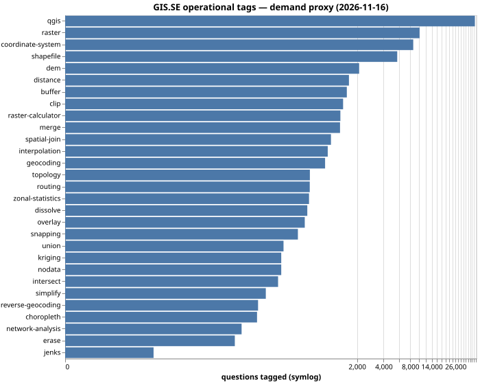

(gis-analysis)=

:::{warning} Supplied snapshot—not a live or independently verified dataset
The figures are all-time counts embedded in the supplied GIS Stack Exchange snapshot.
Its retrieval date and values have not been independently verified here; treat the
counts and derived findings as provisional until the source is re-fetched and checked.
The raw source lives in the [GIS.SE analysis (raw marimo notebook)](analyses/gis-se-analysis.md)
page and renders offline. GIS.SE **selects tasks; it validates nothing**—the oracle
decides correctness.
:::

## What this analysis is (and is not)

::::{grid} 1 1 2 2

:::{card} What it is
A representability scout for the task bank: which geoprocessing operations GIS
practitioners actually ask about, how they rank by execution complexity, and where the
proposed tool surface is blind. All counts are question-tag frequencies, English-only,
tool-ecosystem-skewed toward desktop QGIS/ArcGIS.
:::

:::{card} What it is not
Not a frequency-of-practice measure, not difficulty, not importance, not evidence
that any tool or interface works. It anchors task selection and contamination strata —
never scoring, never the oracle.
:::

::::

## Method (as described in the supplied source; not independently verified)

:::{dropdown} Full method

- **API**: public Stack Exchange API, `site=gis`, no scraping; all content CC BY-SA 4.0.
- `GET /2.3/tags?order=desc&sort=popular&pagesize=75`—popular-tag counts.
- `GET /2.3/questions?order=desc&sort=votes&pagesize=100`—top-voted questions (page 1).
- `GET /2.3/tags/{list}/info?site=gis`—exact counts for 29 requested operational tags
  (non-existent tags silently dropped; `snap` resolved to `snapping`).
- **Frames**: `tag_counts` (29×2, counts per operational tag) and the top-voted
  seeded-candidate slice (750 rows × 8 cols, sort=votes desc, pages × 25 for the six
  seeded candidates: **buffer, clip, spatial-join, overlay, zonal-statistics, dissolve**).
- **Execution**: the supplied source describes an interactive analysis; its execution date and counts have not been independently verified. Chart: horizontal bars on a **symlog** scale (a plain log cannot draw zero-baselined bars).
- **Web cross-checks**: two canonical-operation guides (see Sources)—used to sanity-check
  the operation set, not as evidence of effectiveness.
- **Retention**: this page holds aggregates only; the supplied snapshot with an
  unverified retrieval date lives in the [raw notebook page](analyses/gis-se-analysis.md),
  with the fetch recipe and refresh notes.

:::

## Headline findings

1. **CRS is the loudest GIS pain point.** `coordinate-system` = 8 647—more than any
   operational tag—and it dominates the top-100 most-voted questions (EPSG:3857 vs 4326,
   datum vs projection, axis order). The confused-concepts layer is bigger than the
   recipes layer. Good news for trap-task strategy: axis-order/CRS-units traps ask
   well-worn questions, not exotic ones.
2. **The operational core is small.** About a dozen tags cover hands-on asks: buffer,
   clip, merge, spatial-join, overlay, dissolve, zonal-statistics, raster-calculator —
   exactly the proposed catalogue's primitives.
3. **Voting ≠ doing.** The most-upvoted questions are conceptual (CRS, web mapping),
   not operational recipes—"most common question" and "most common task" are different
   distributions. The bank needs both: inherited conceptual traps and constructed
   operational pipelines.
4. **Cartography tags are rare** (`choropleth` 147, `jenks` 9) and standard-class.
   Low SE demand is not low experimental value—the C-family counter-case stands on
   the literature, not on SE volume.
5. **Nobody asks about checkers.** No "validate my CRS/geometry" quality tag exists —
   validation lives inside other questions. This supports predicates-as-oracle by design.
6. **Software context**: qgis 43 077 dominates; the audience is desktop/scripting
   QGIS + ArcGIS—matching the study's toolchain choice.

## Frequency anchor (all-time counts, site=gis)

Bolded rows are the six seeded task-bank candidates.

| Tag | Count | Tag | Count | Tag | Count |
|---|---:|---|---:|---|---:|
| qgis | 43 077 | postgis | 9 580 | pyqgis | 7 931 |
| python | 12 249 | arcpy | 10 662 | raster | 10 203 |
| coordinate-system | 8 647 | gdal | 6 448 | shapefile | 5 698 |
| field-calculator | 2 562 | dem | 2 113 | fields-attributes / attribute-table | 2 003–2 330 |
| distance | 1 620 | **buffer** | **1 533** | **clip** | **1 391** |
| raster-calculator | 1 296 | merge | 1 284 | **spatial-join** | **1 014** |
| interpolation | 932 | geocoding | 870 | topology | 585 |
| routing | 583 | zonal-statistics | **572** | **dissolve** | **547** |
| **overlay** | **512** | snapping | 428 | union | 294 |
| kriging | 277 | nodata | 277 | intersect | 255 |
| simplify | 185 | reverse-geocoding | 151 | choropleth | 147 |
| network-analysis | 98 | erase | 82 | jenks | 9 |

Context (popular non-task tags): qgis-3 4 556 · qgis-plugins 3 175 · arcgis-desktop
21 012 · arcgis-pro 4 126 · arcgis-server 2 749 · arcmap 7 827 · google-earth-engine
5 822 · leaflet 4 195 · openstreetmap 3 330.

*GIS.SE operational tags—demand proxy (supplied snapshot; retrieval date not independently verified). Symlog scale keeps the zero baseline. Top tags by question count; CC BY-SA 4.0.*

## Complexity ranking of the common tasks

Tiers follow the task-suite rubric (tier 1–5 from human tool/step counts). Fam:
P = prepare/IO · A = analysis · C = cartography. **SE anchor** = tag count from the
fetch. **Coverage** = the proposed catalogue (describe/reproject/filter/
buffer/overlay/dissolve/spatial_join/zonal_stats/aggregate/reproject_raster/raster_clip/
reclassify/classify_jenks/render_choropleth).

| # | Task (canonical form) | Fam | Tier | n_tools_h | SE anchor | Coverage | Trap (oracle-relevant) |
|---|---|---|---|---:|---|---|---|
| 1 | Identify/set CRS; reproject | P | 1–2 | 1 | 8 647 | `reproject`, `describe_layer` | axis order (4326 vs 2180), degrees vs metres |
| 2 | Select by attribute / filter | P | 1 | 1 | ~2 000–2 330 | `filter` | NULL handling, wrong field type |
| 3 | Field calculation (area, length, units) | P | 1–2 | 1 | 2 562 | **gap**—not exposed | unit mismatch (m² vs ha), CRS-aware area |
| 4 | Format conversion (shp→gpkg, CSV→points) | P | 1 | 1 | 1 474 + 2 701 (geojson) | fixture-time, **not an agent task** | encoding, CRS loss on export |
| 5 | Buffer | P | 2 | 1 | 1 533 | `buffer` | distance unit (deg vs m), ring semantics |
| 6 | Clip / erase | P | 2 | 1 | 1 391 + 82 | `overlay` (intersection/difference) | invalid input geometry → silent GEOS failure |
| 7 | Merge / append layers | P | 2 | 1 | 1 284 | **gap**—not exposed | schema/CRS mismatch across inputs |
| 8 | Dissolve by attribute | P | 2 | 1 | 547 | `dissolve` | premature dissolve (loses counts) |
| 9 | Choropleth (classified) | C | 2–3 | 2–3 | 147 + 9 + 2 390 (symbology) | `classify_jenks`, `render_choropleth` | classification before normalization |
| 10 | Raster clip/mask; window | P/A | 2–3 | 1–2 | 10 203 (raster, broad) | `raster_clip` | NoData propagation, resampling on read |
| 11 | Distance/proximity (within k of) | A | 2–3 | 1–2 | 1 620 | **weak**—buffer+join workaround; no `point_distance` | planar vs geodesic |
| 12 | Spatial join (points-in-polygon, counts) | A | 3 | 1–2 | 1 014 | `spatial_join` | predicate choice (intersects vs within); boundary double-counting |
| 13 | Buffer→clip→dissolve (schools/districts) | P | 3 | 3–5 | 1 533+1 391+547 | full surface | compound error propagation (CRS→buffer→clip) |
| 14 | Overlay (union/intersection/difference) | A | 3 | 1–3 | 512 + 255 + 294 | `overlay` | slivers, topology cracks, attribute merge rules |
| 15 | Zonal statistics (raster stats per polygon) | A | 3 | 1–2 | 572 | `zonal_stats` | NoData policy, partial-cell policy, MAUP |
| 16 | DEM derivatives (slope/aspect/hillshade) | A | 3–4 | 1–3 | 2 113 | **gap**—not exposed | z-factor units, NoData edges |
| 17 | NoData handling in raster pipelines | P/A | 3 | 1–2 | 277 | `zonal_stats(nodata_policy)`, `describe_raster` | silent zero-fill (classic silent corruption) |
| 18 | Raster-calculator map algebra | A | 3–4 | 1–2 | 1 296 | **partial**—`reclassify` only | cell alignment, mask extents, NoData×0 |
| 19 | Labeling/annotation placement | C | 3 | 2–3 | 2 456 (labeling) | **not exposed**—descriptive only | collisions unmeasurable by predicate |
| 20 | Geocoding / reverse geocoding | P | 3 | 1 | 870 + 151 | **out of scope** (needs network) | match ambiguity; inherently soft oracle |
| 21 | Interpolation (IDW; kriging) | A | 4 | 1–2 | 932 + 277 | **not exposed** | model choice, anisotropy |
| 22 | Network analysis (shortest path, isochrones) | A | 4–5 | 2–5 | 583 + 98 | **out of scope v1** | graph defects, direction/turn costs |
| 23 | Watershed / flow accumulation | A | 4–5 | 2–4 | (dem 2 113) | **out of scope v1** | pour-point snapping, NoData sinks |
| 24 | Topology validation & repair | P/A | 4–5 | 2–4 | 585 + 428 | middleware + oracle; **no agent tool by design** | repair masks upstream error |
| 25 | Simplify geometry (Douglas–Peucker) | P/A | 2–3 | 1 | 185 | **gap** | topology break, tolerance units |
| 26 | Concave hull / alpha shapes | A | 4 | 1–2 | exemplary top-100 question (145 votes) | **not exposed** | no unique answer (soft oracle) |
| 27 | Zonation/aggregation sensitivity (MAUP) | A | 5 | 2–5 | no SE tag; literature-anchored | `aggregate`, `zonal_stats` at two zonations | aggregation bias; constructed task |

**Complexity distribution of demand.** Tier 1–2 (CRS fixes, filters, buffer/clip/merge)
accounts for the overwhelming bulk of SE volume; tier 3 (pipelines, spatial join,
zonal stats) is where agents live or die—the A-family sweet spot; tier 4–5 appears
rarely but maps cleanly onto expert tasks and makes good *constructed* tasks.

## Gap analysis vs the proposed catalogue

Missing from the surface that SE says people want:

- `calculate_field` (2 562)—either expose it or GIS-SE-derived tasks involving attribute computation are not agent-expressible.
- `merge` (1 284)—trivial to add, high demand.
- `point_distance` / proximity (1 620)—buffer+join is a workaround, weak for small k.
- `simplify` (185)—low demand; skip.
- Raster: `slope/aspect` and general map algebra—highest-demand raster gap (dem 2 113, raster-calculator 1 296). If the suite gains a second raster task, reconsider a `raster_calc` with a constrained expression grammar (typed enums, not free text).
- Geocoding: deliberately out (offline constraint)—soft oracle anyway.
- Labeling/cartography cosmetics: stays descriptive—no typed tool possible.

:::{important} Catalogue-freeze rule (unchanged)
Whichever subset is exposed must be frozen and hashed before runs. Adding
`calculate_field` / `merge` / `point_distance` **before** freeze is a legitimate
instrument change; after freeze it invalidates the run log.
:::

## Task-bank implications (for the §6.4 freeze)

- **Inherited candidates** (SE-derived, `contamination: inherited`, CC BY-SA 4.0 attribution required): buffer→clip→dissolve pipeline; points-in-polygon join + counts; CRS axis-order reprojection trap (behind 8 647 asks); spatial-join predicate disambiguation.
- **Constructed candidates** (author-made, `contamination: constructed`, CC0): MAUP dual-zonation; NoData-in-zonal-stats; Jenks under normalized vs raw attribute (C-family counter-case); topology/DE-9IM `touches`/`covers` predicate task. Low-SE-volume tasks are *preferable* constructed candidates—no pretraining leakage plausible.
- **Do not inherit verbatim without attribution**—every GIS.SE question carries `content_license: CC BY-SA 4.0`; closed/locked questions may lack the licence field—treat those as unusable for derivation.
- **Jenks (9 questions) ≠ unimportant**—frequency is a demand measure, never a difficulty or representativeness measure.
- **GIS-SE demand data cannot validate the oracle**—it only informs task selection and contamination strata.

## Limitations (read before citing this page)

- Counts are all-time and tool-ecosystem-skewed (ArcGIS|QGIS dominate); no time series, no geography filter, English-only.
- Votes on the top-100 track **conceptual confusion**, not operational need; ~half the headline questions are CRS/datum explainers.
- Tag counts confound "asking" with "doing"; many high-count tags are installation/config/software topics, not tasks.
- Complexity tiers are expert estimates, not measurements; they anchor on the task-suite rubric, pending pilot calibration.
- "Most common GIS tasks ranked by complexity" is not a number GIS.SE publishes; this page is a synthesis, not a dump.
- Licensing: inherited prompts must preserve attribution; constructed traps are the low-risk default.

## Sources (supplied snapshot; retrieval date unverified)

1. `api.stackexchange.com/2.3/tags?order=desc&sort=popular&site=gis&pagesize=75`—popular-tag counts.
2. `api.stackexchange.com/2.3/questions?order=desc&sort=votes&site=gis&pagesize=100`—top-voted questions.
3. `api.stackexchange.com/2.3/tags/buffer;clip;…;extent/info?site=gis`—exact operational counts.
4. Web cross-checks (operation-set sanity only; not evidence of effectiveness): a university spatial-data-processing guide (buffer, dissolve, centroid, spatial selection/joins, overlay); a vendor vector-operations explainer (clip/intersect/difference/union/buffer/dissolve/simplify); an ArcGIS geoprocessing overview (buffer, clip, intersect, union, dissolve, merge, erase).
5. All GIS Stack Exchange content: **CC BY-SA 4.0**—attribution carried in task `provenance.license` fields and in the repository's attribution file at freeze.
