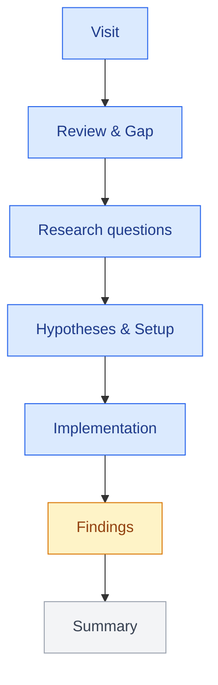

:::{important} Pre-experiment—not frozen
{width=18px} This site documents a proposed
experiment, not a finished one. The protocol is open until the preregistration tag
`v1.0-prereg`. Pages under *Findings* are explicit **ToDo** pages and are empty on
purpose. Nothing here is a result, a recommendation, or a ranking of interfaces.
:::

## The question

::::{grid} 1 1 2 2

:::{card} Main question
Does the way an LLM agent **reaches** geospatial processing operations—typed
Model Context Protocol (MCP) tools, or unrestricted code generation—change the
correctness of the artefact it actually executes?
:::

:::{card} Scope

- Nine geoprocessing operations; P/A/C task families.
- One pinned model (OpenCode-hosted BigPickle, free tier).
- One pinned engine-side oracle (ISO 19157-derived predicates; execution required).
- Confirmatory comparison: **Arm A (typed MCP) vs Arm B (PyQGIS CodeGen)**.
- N ≥ 80 tasks at scale; n = 10 pilot estimates effects only.
- Human analyst reference is **descriptive**, not an arm.
:::

::::

## Abstract (pre-experiment)

LLM agents fail on realistic tool spaces far more often than benchmarks suggest, and
half the failures are retrieval/schema errors rather than reasoning errors
[@luo2025mcpuniverse; @mo2025livemcpbench]. In geospatial work, the cost of a confident
but wrong artefact is silent corruption of the dataset, not a visibly broken demo. This
project asks whether the integration interface—typed MCP tools versus code generation—
is a *causal factor* on executed-artefact quality, holding model, engine, data and oracle
constant, and enforcing nothing about "MCP is better" in advance. The gap, the hypotheses,
the setup, and—later—the results are organised below as a single road from question to
summary.

## The arc of this site

| Stage | Where | State |
|---|---|---|
| Visit (this page) | `index` | Written; scope pending freeze |
| Literature review & gap | [Literature review](review/literature-review.md) | {width=14px} Draft—pre-experiment distillation |
| Research questions | [Research questions](review/research-questions.md) | {width=14px} Drafted; nulls verbatim |
| Hypotheses & experiment setup | [Hypotheses](study/hypotheses.md) · [Experiment](study/experiment.md) | {width=14px} Drafted from the design |
| Implementation | [Implementation](study/implementation.md) | {width=14px} CLI and QGIS plugin prototype; no study runs |
| Findings (results → interpretation → summary) | [Results](findings/results.md) → [Interpretation](findings/interpretation.md) → [Summary](findings/summary.md) | {width=14px} ToDo—empty on purpose |
| Evidence & reproducibility | [Provenance](provenance.md) · [SE demand analysis](analysis.md) · [Reproducibility](reproducibility.md) | {width=14px} Written; see CC BY-SA note |

## Reading order

1. [Literature review](review/literature-review.md)—what is known, and the empty cell.
2. [Research questions](review/research-questions.md)—the RQs the gap justifies (H₀ verbatim).
3. [Hypotheses](study/hypotheses.md)—nulls, alpha discipline, gatekeeping, what would count as evidence.
4. [Experiment](study/experiment.md)—arms A/B/C/D, task-suite v1, coverage and freeze order.
5. [Implementation](study/implementation.md)—what exists today and what appears at freeze.
6. [Findings](findings/results.md)—ToDo; nothing has been run.
7. [Provenance](provenance.md)—where the task bank comes from and under what licence.
8. [SE demand analysis](analysis.md)—the representability evidence behind the task bank.

## Provenance of the design

The experiment design is not invented in this repository; it is a rendering of the
pre-experiment design specification maintained outside this repository (freeze discipline:
append-only, preregistration at `v1.0-prereg`). If this site and the specification ever
disagree, the specification governs until freeze, and the frozen tag governs after.
This site is CC BY-SA 4.0 for text (task-derived material) and MIT for code scaffolding;
inherited GIS StackExchange material is CC BY-SA 4.0 with attribution—see
[Provenance](provenance.md).
