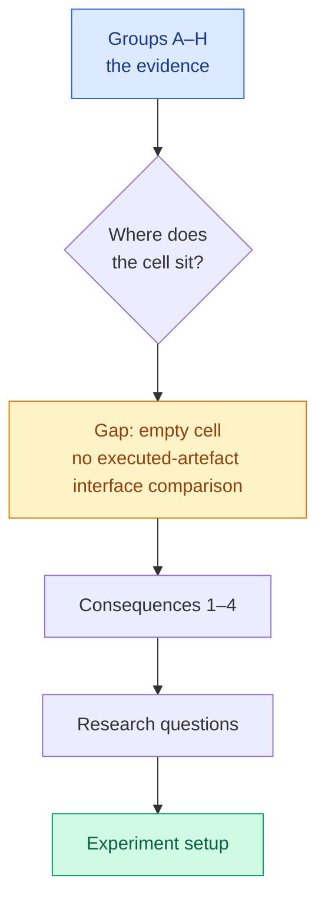

(literature-review)=

:::{important} Pre-experiment—not frozen
This is a condensed, corpus-keyed pre-experiment review for onboarding. Every claim is
keyed to the corpus in `bibliography.bib`; nothing is imported from outside it and
nothing is invented. It orients the reader to the design; it is not the thesis's
literature review.
:::

## How to read this page

The review answers three questions in order: **what exists** (eight evidence groups,
A–H), **why the target cell is empty** (the gap, with the adversarial floor), and
**what the evidence forces** (four design consequences, enforced in
[Experiment](../study/experiment.md)). Citations are corpus keys, rendered as bracketed
at-references; the corpus and its provenance are described in the last dropdown.

## State of the field in seven numbers

::::{grid} 1 2 4 4

:::{card} 29–44 %
frontier success on realistic MCP tool spaces; integration **degrades** with more servers [@luo2025mcpuniverse; @song2025helpor]
:::

:::{card} ≈ ½
of all failures are retrieval errors, not reasoning errors [@mo2025livemcpbench]
:::

:::{card} &lt; 25 %
GPT-4o pass^8 on τ-bench retail—single-trial success flatters reliability 20–40 pp [@yao2024taubench; @gupta2026reliabilitybench]
:::

:::{card} ≈ 32.7 %
best executed-artefact GIS agent, tolerance-strict [@gisagentbench2026]
:::

:::{card} + 26.6 pp
spatial correctness from contract + repair in code generation [@geocontra2026]
:::

:::{card} 97.14 / 85.71 %
codegen vs function calling—GeoJSON domain only, no spatial oracle [@luo2026geojson]
:::

:::{card} &lt; 57 %
end-to-end success of generated MCP projects [@yang2026mcpgen]
:::

:::{card} 42 → 95 %
agent success after grader audit in eval-discipline work—score the outcome, not the trajectory [@anthropic2026evals]
:::

::::

## The evidence, group by group

Each group below states what it covers, what it establishes, and what it leaves open.
Expand the dropdowns; nothing here substitutes for reading the primary sources.

:::{dropdown} A—GIS canon & standards (the oracle vocabulary)
**Covers.** Data-quality elements (ISO 19157; 2013 standard superseded by 19157-1:2023, element names remain the mapping vocabulary) [@iso19157]; geometry schema and topology [@iso19107]; metadata [@iso19115]; DE-9IM topological predicates [@egenhofer1991]; uncertainty of spatial data [@zhangGoodchild2002; @goodchildGopal1989; @burrough2015; @longley2015]; error propagation [@heuvelink1998]; semantics [@kuhn2005; @kuhn2012]; MAUP [@openshaw1984maup]; Jenks classification [@jenks1971]; cartography canon [@slocum2009; @maceachren1992; @monmonier2018; @harrowerBrewer2003]; ISO-style quality framing for LLM outputs [@shingleton2025geoquality].

**Establishes.** The oracle's predicate families are standard GIScience quality elements—not bespoke checks, not vibes.

**Leaves open.** Which predicates bind to which interfaces, and whether enforcement depth at the tool boundary changes what ships. That is the experiment, not the canon.
:::

:::{dropdown} B—Autonomous GIS (what agents demonstrably do)
**Covers.** Vision and autonomy levels [@li2023autonomous; @li2025autonomous]; retrieval agents [@ning2025autonomous]; QGIS-as-tools multi-agent systems, fine-tuning for execution success (100 % exec / 87.5 % semantic; ceiling degrades with complexity) [@mansourian2026multiagent]; code-generation multi-agents with RAG over syntax corpora (+7.59–26.09 % gains) [@wu2025geocolab]; MCTS over programs [@chen2024geoagent]; 1 800 controlled end-to-end runs with Cliff's δ and Kendall τ = 0.94—single-agent ReAct beats dual-agent orchestration on cloud backends [@han2026gisclaw]; 1 778 expert reasoning steps with step-wise scoring [@shabbir2025thinkgeo]; open-weight cost–capability (≈ 93 % of Claude's capability at 11.6× lower cost) [@diazireland2026geonatureagent]; maturity snapshots [@liang2026geoagentic; @openearthagent2026].

**Establishes.** GIS agents exist across the autonomy spectrum, and the bottleneck is executional reliability—not intent, not planning prose.

**Leaves open.** Whether the interface (typed MCP vs code generation)—rather than the model, the harness, or the prompt—moves executed-artefact correctness.
:::

:::{dropdown} C—Protocols (what MCP is and how fragile it is)
**Covers.** The normative specification [@anthropicMCP]; ecosystem reviews [@nargund2025mcp; @strickland2026pareto; @mastouri2025automcp]—88.6 % of servers are REST wrappers, a median 19 % of operations exposed, catalogues are edited artefacts, generated servers go 76 % → 94.2 % after repair; catalogue sizing as a controlled variable, 4-tool optimum, +16.4 pp completion vs fine-grained primitives [@paschalides2026mcpgranite]; a 16-lifecycle-activity threat taxonomy across 16 scenarios and four attacker classes [@hou2025mcp]; protocol-level flaws with ATTEST-style repair (MCP amplifies attack success by 23–41 %) [@maloyan2026breaking]; 12 attacks / 2 000 instances with an NRP robustness metric—stronger models are *more* vulnerable [@zhang2025msb]; error accumulation O(√T) with re-grounding ≈ every 9 steps [@fan2026infofidelity]; OGC lineage (WPS 2.0 / OGC API Processes) [@ogcWps2; @ogcApiProcesses]; adjacent client protocol [@agentClientProtocol].

**Establishes.** The protocol is real, fragile, and catalogue-sensitive; enforcement at the boundary is a live design axis, not a detail.

**Leaves open.** Whether enforcement depth is *the* mechanism, separable from protocol identity—the C3 claim of this study.
:::

:::{dropdown} D—General tool-use & agent benchmarks (instrument canon + grim baseline)
**Covers.** pass^k methodology [@yao2024taubench]; ReliabilityBench's R(k,ε,λ) surface [@gupta2026reliabilitybench]; MCP-Atlas (claim-coverage@0.75; 63.3 % cognitive failures) [@bandi2026mcpatlas]; MCP-Bench (28 servers, 250 tools, cross-tool coupling) [@wang2025mcpbench]; LiveMCP-101 (7 failure modes; TSR/ARS) [@yin2025livemcp]; MCPToolBench++ (AST score, 4 k servers) [@fan2025mcptoolbench]; LiveMCPBench (retrieval ≈ ½ of failures) [@mo2025livemcpbench]; MCP-Universe (frontier 29–44 %; dilution) [@luo2025mcpuniverse]; MCPGAUGE (integration degrades effectiveness) [@song2025helpor]; GeoMCP's publish–find–bind design (a design precedent, not effectiveness evidence) [@ogsagent2026]; eval discipline—grade the outcome, not the trajectory (CORE-Bench 42 → 95 % after grader audit) [@anthropic2026evals].

**2026 wave.** Executed-project generation [@yang2026mcpgen]; live-server effect scoring with pass^3 collapse [@kaminski2026dynamicmcpbench]; evolution robustness across 123 servers [@liu2026mcpevolbench].

**Establishes.** The measurement machinery (pass^k, claim coverage, live servers) and the grim baseline—every instrument this experiment borrows already exists.

**Leaves open.** All of it in the GIS regime, under an ISO-predicate oracle, on the interface axis.
:::

:::{dropdown} E—GIS-agent benchmarks (the competitive set)
**Covers.** GeoAnalystBench (50 expert tasks; code-style validity ≠ correctness—"right shape, wrong numbers") [@zhang2025geoanalystbench]; GeoAgentBench (PEA metric, Last-Attempt Alignment; Plan-and-React > ReAct; ≈117–133 tools—cite the published version) [@yu2026geoagentbench]; GISAgentBench (349 tasks, strict tolerances, 32.7 % best-case, IoU ≥ 0.5) [@gisagentbench2026]; GeoBenchX (unsolvable-task rejection scoring) [@krechetova2025geobenchx]; GeoContra (contracts + repair, +26.6 pp, 7 079 tasks / 11 models) [@geocontra2026]; ThinkGeo, OpenEarthAgent, GeoNatureAgent [@shabbir2025thinkgeo; @openearthagent2026; @diazireland2026geonatureagent].

**Establishes.** Executed GIS benchmarks exist, are brutal, and measure the wrong factor—none manipulates the interface with an ISO predicate oracle.

**Leaves open.** Exactly the cell in the next section.
:::

:::{dropdown} F—MCP × GIS (the thin intersection everyone claims and nobody operationalised)
**Covers.** The GeoJSON head-to-head (codegen 97.14 % vs function calling 85.71 %) [@luo2026geojson]; tool-exposure guidance for GNSS toolchains [@tool_exposure_gnss_2026]; GeoMCP server design [@ogsagent2026]; discovery-MCP benchmark (agents on par with humans on parts of metadata search) [@ichms2026_mcp_geodata]; the ICHMS GIS-MCP cluster [@gis-mcp-server-cluster-2026].

**Establishes.** What exists: systems, specs, and one non-GIS, non-oracle-scored head-to-head. What does not exist: an executed-artefact comparison on the interface axis with ISO predicates.

**Leaves open.** The entire question—this experiment is that comparison.
:::

:::{dropdown} G—Cartographic judgement (the C-family counter-case)
**Covers.** ColourBrewer compliance [@harrowerBrewer2003]; intent-driven colour [@gauslaa2026intentcolour]; choropleth LLM case [@pannoon2025choropleth]; visual variables [@maceachren1992; @slocum2009]; map-abuse canon [@monmonier2018]; Jenks classification [@jenks1971].

**Establishes.** Cartography is judgeable but not oracle-gradable pass/fail; it is consumed here as *descriptors* (pre-registered counter-case), never as a gate.

**Leaves open.** Whether cartographic tasks behave differently under the two interfaces—pre-registered as the RQ3 counter-case.
:::

:::{dropdown} H—Method (why the design looks like this)
**Covers.** Design-science research [@peffers2007design]; the analysis kit—paired binary tests, mixed models, gatekeeping, minimum detectable effects [@anthropic2026evals]; agent-run reproducibility practice [@nust2018; @konkol2019]; instrument/usability framing [@nivala2008]; pass^k as the reliability unit (Group D/E).

**Establishes.** The method is standard; the novelty is the enforced constant on every axis except the interface.

**Leaves open.** Nothing methodological—everything depends on freeze discipline (see [Hypotheses](../study/hypotheses.md)).
:::

## The gap—the empty cell

:::{important} The empty cell (verbatim logic)
No study holds **engine + model + data + oracle constant**, manipulates **only the integration interface** (typed MCP vs code generation), and scores **executed GIS artefacts** against ISO 19157 predicates under **repetition (pass^k)**, with contamination-aware strata and preregistered tolerances.
:::

Why the cell is still empty, in five independent reasons [@mastouri2025automcp; @iso19157]:

| # | Why it survives |
|---|---|
| 1 | It is expensive—N runs × N tasks × N interfaces, and GIS artefacts need per-tool predicates |
| 2 | The answer is telegraphed directionally (GeoJSON 97 / 86; MCPGAUGE degradation) [@luo2026geojson; @song2025helpor] |
| 3 | Scoring asymmetry—code artefacts execute freely; tool artefacts need per-tool checks |
| 4 | Catalogue confounds make "MCP" ill-defined as a treatment [@mastouri2025automcp] |
| 5 | GIS semantics (CRS, topology, MAUP) punish weak judges [@iso19157; @openshaw1984maup; @egenhofer1991] |

**Nearest neighbours and what they leave open**—ten works, each filling part of the cell, none the whole:

| Work | What it fixes | What remains open |
|---|---|---|
| GeoJSON Agents [@luo2026geojson] | head-to-head interface comparison | different domain, FC≠MCP protocol, multi-agent confound, non-spatial judging |
| GeoContra [@geocontra2026] | contracts + repair for codegen | no MCP arm; task templates, not the interface factor |
| GeoAgentBench [@yu2026geoagentbench] | executed sandbox + PEA | tool-calling only; no codegen arm; non-typed catalogue |
| GISAgentBench [@gisagentbench2026] | artefact ground truth; tolerances | no interface manipulation; binary match, not ISO predicates |
| MCPGen [@yang2026mcpgen] | executed MCP projects, <57 % e2e | project generation, not the interface factor, not GIS |
| DynamicMCPBench [@kaminski2026dynamicmcpbench] | live-server effect scoring | general domains; single-configuration |
| MCPEvol-Bench [@liu2026mcpevolbench] | 123-server evolution robustness | different question (drift); enables the frozen-catalogue rule |
| ReliabilityBench [@gupta2026reliabilitybench] | pass^k methodology | scheduling/travel domain; no interface factor |
| Shingleton & Basiri [@shingleton2025geoquality] | ISO-style quality for LLM outputs | geoparsing scale only; not multi-tool artefacts |
| Discovery MCP [@ichms2026_mcp_geodata] | MCP discovery vs humans | metadata search, not artefact execution |

:::{warning} Adversarial floor (what would close the gap)
Any 2026–2027 work doing GIS artefact MCP-vs-codegen with executed ISO scoring appearing
before freeze forces this study to re-scope to the mechanism leg (enforcement depth,
C3) and the instrument (C1). The headline falls; the science survives—the
re-scoping rule is written now, not negotiated later.
:::

**Synthesis in one line.** The field is code-generation-first for GIS [@li2023autonomous; @li2025autonomous; @wu2025geocolab] and MCP-first only as design [@ogsagent2026]; every benchmark manipulates models or architectures, none manipulates the **interface paradigm** with executed, ISO-scored artefacts—and the 2026 wave sharpened execution difficulty and liveness, not the factor.

## What the evidence forces (design consequences)

::::{grid} 1 1 2 2

:::{card} 1—The interface is the only difference
Catalogue constant: one server, one tool surface, one hash; depth is a single flag. Anything else measures catalogue design, not the interface [@mastouri2025automcp; @paschalides2026mcpgranite].
:::

:::{card} 2—The oracle is the judge
Correctness is defined by executed-artefact predicates (ISO 19157 family), never by LLM judgement or human impression [@iso19157; @anthropic2026evals; @shingleton2025geoquality].
:::

:::{card} 3—Leakage is a stratum, not a hope
Inherited vs constructed tasks are analysed separately; inherited tasks demand CC BY-SA attribution and contamination tags (see [Provenance](../provenance.md)).
:::

:::{card} 4—Reliability is pass^k
One success is not success; r = 4 repetitions per task, reported as pass^4 with ICC—the unit of evidence is repeatability [@yao2024taubench; @gupta2026reliabilitybench].
:::

::::

These four consequences bind the [research questions](research-questions.md), the [hypotheses](../study/hypotheses.md), and the [experiment setup](../study/experiment.md).

:::{dropdown} Corpus administration (how to trust the citations)
The corpus is 81 entries in `bibliography.bib`, plain biblatex, each carrying fulltext open-access provenance (record source, retrieval date, licence). No paywall-sourced full text; every key cited on this page resolves in the corpus snapshot shipped with this site; keys are never invented. Groups A–H organise the evidence in the order the design was assembled. If a claim matters, the key sits next to it—if a key is missing, the claim does not ship.
:::
